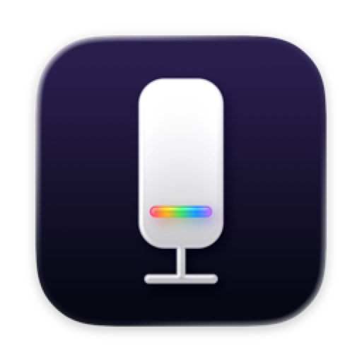
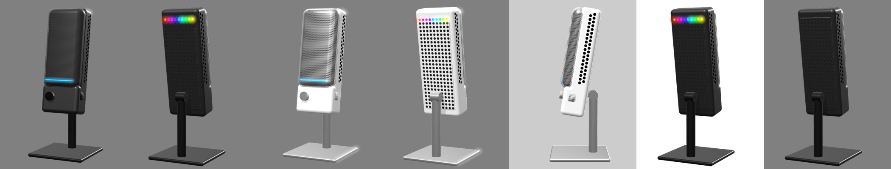

# Capsule Light

A native macOS app for the lighting of the **NZXT Capsule Elite** USB microphone. NZXT's own app (CAM) is Windows-only; this one runs on Macs.

> **Unofficial.** Not affiliated with, endorsed by or supported by NZXT. "NZXT" and "Capsule Elite" are trademarks of their owner and are used here only to say which device this works with. Use at your own risk (see [LICENSE](LICENSE)).

<p align="center"></p>



## What it does

- **Front light bar** (7 LEDs): color, brightness, on/off.
- **Rear lights** (9 LEDs): solid color or one of 9 effects (Rainbow Wave, Rainbow Radial, Color Pulse, Covering Marquee, Color Shift, Solid Gradient, Cylon Red, Cylon Multicolor, Disco), with speed, brightness and on/off.
- **Presets**: save, rename, update, delete, and restore factory lighting.
- **3D model** of the mic in your current colors. Drag to rotate; it turns to the side you're editing. Black or white finish.
- **Menu-bar item** with presets, on/off and brightness, and a **desktop widget** (small and medium) with preset buttons.

The mic stores its settings itself, so they stay after you unplug it or quit the app.

**Safety:** the app only sends the lighting commands documented in [docs/PROTOCOL.md](docs/PROTOCOL.md), checks that the mic acknowledges each one, and never sends anything firmware-related.

**Tested on:** macOS 26.6 on Apple Silicon with a black Capsule Elite (USB `bcdDevice` 0x1005). If you try another setup, please open an issue with what worked.

## Requirements

- macOS 26 or newer
- Xcode 26 or newer (free, from the App Store)
- An NZXT Capsule Elite connected by USB

No Apple developer account is needed: the app is built on your Mac and signed to run locally.

## Install with your coding agent

Paste this into Claude Code, Codex or a similar agent running on your Mac:

> Install Capsule Light from https://github.com/Eric-Savvi/capsule-light by following its AGENTS.md.

The agent checks your Mac, builds the app, installs it to `/Applications` and tells you the two clicks only you can do. The exact steps are in [AGENTS.md](AGENTS.md).

## Install by hand

```bash
git clone https://github.com/Eric-Savvi/capsule-light.git
cd capsule-light
xcodebuild -project Capsule.xcodeproj -scheme Capsule -configuration Release -derivedDataPath build build
ditto build/Build/Products/Release/Capsule.app "/Applications/Capsule Light.app"
open "/Applications/Capsule Light.app"
```

On first launch macOS asks whether Capsule Light may "access data from other apps": click **Allow**. That's the storage it shares with its widget.

To add the widget: right-click the desktop → **Edit Widgets…** → search "Capsule".

To update: `git pull`, then run the build and `ditto` lines again.

## Troubleshooting

- **"Not connected"**: plug the mic in directly (not through a hub to start with). It should appear in System Information → USB as "NZXT Capsule Elite". The app reconnects by itself.
- **The widget doesn't appear in the gallery**: macOS may still list an old or deleted copy of the app. Remove stale entries, then reinstall:
  ```bash
  LSREG=/System/Library/Frameworks/CoreServices.framework/Frameworks/LaunchServices.framework/Support/lsregister
  $LSREG -dump | grep -E '^path:.*Capsule'   # then: $LSREG -u <each path that isn't in /Applications>
  killall chronod
  ```
- **Mute**: the front turns red while muted. That red is set by the mic's firmware and can't be changed.

## Command line (optional)

Two Python scripts talk to the mic directly (`pip3 install hidapi`):

```bash
python3 capsule_read.py                         # read-only: prints the raw settings
python3 capsule_light.py show                   # current lighting as JSON
python3 capsule_light.py set front 00d2ff 80    # front color and brightness
python3 capsule_light.py effect rear rainbow-wave 5 100
python3 capsule_light.py restore                # back to the saved state
```

## Project layout

| Path | What |
|---|---|
| `Capsule/` | the app: window, menu bar, store, color picker |
| `CapsuleWidget/` | the widget extension |
| `Shared/` | HID access, lighting model, 2D and 3D mic views |
| `docs/PROTOCOL.md` | the USB HID protocol and safety rules |
| `docs/SPEC.md` | what the app does |
| `Tests/LightingCheck/` | self-check for the lighting mapping (`swiftc Shared/CapsuleHID.swift Shared/Lighting.swift Tests/LightingCheck/main.swift -o /tmp/lc && /tmp/lc`) |

## License

[MIT](LICENSE)
